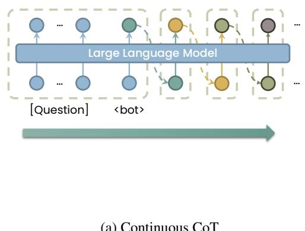
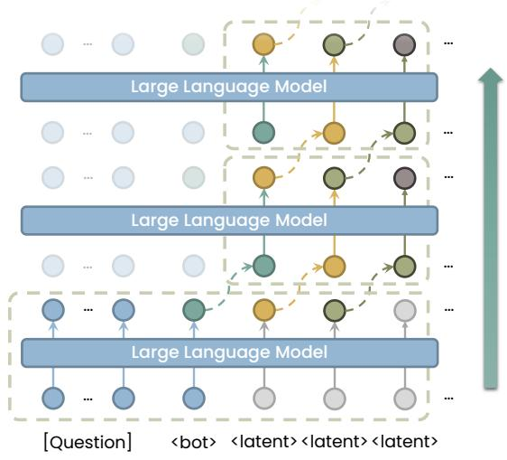
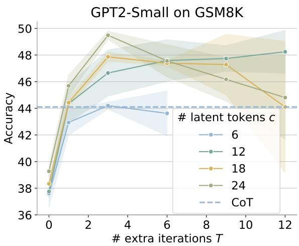
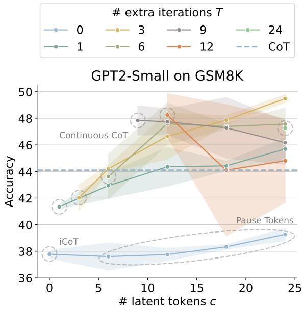
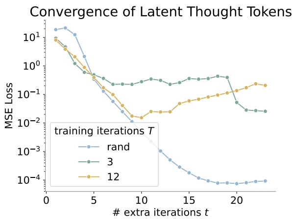
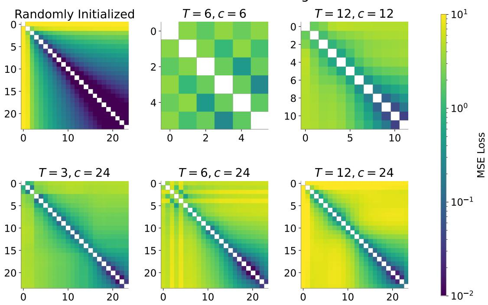
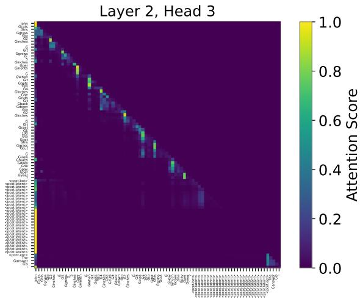
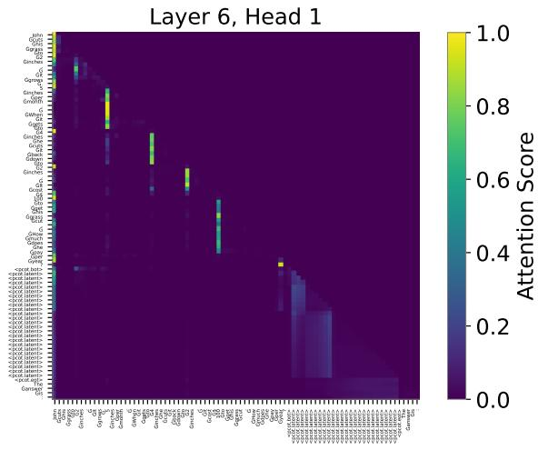

# Parallel Continuous Chain-of-Thought with Jacobi Iteration

Haoyi Wu, Zhihao Teng, Kewei Tu

School of Information Science and Technology, ShanghaiTech University Shanghai Engineering Research Center of Intelligent Vision and Imaging {wuhy1, tengzhh2022, tukw}@shanghaitech.edu.cn

## Abstract

Continuous chain-of-thought has been shown to be effective in saving reasoning tokens for large language models. By reasoning with continuous latent thought tokens, continuous CoT is able to perform implicit reasoning in a compact manner. However, the sequential dependencies between latent thought tokens spoil parallel training, leading to long training time. In this paper, we propose Parallel Continuous Chain-of-Thought (PCCoT), which performs Jacobi iteration on the latent thought tokens, updating them iteratively in parallel instead of sequentially and thus improving both training and inference efficiency of continuous CoT. Experiments demonstrate that by choosing the proper number of iterations, we are able to achieve comparable or even better performance while saving nearly 50% of the training and inference time. Moreover, PC-CoT shows better stability and robustness in the training process. Our code is available at https://github.com/whyNLP/PCCoT.

## 1 Introduction

Chain-of-thought (CoT) enables large language models (LLMs) to solve complex problems by generating intermediate reasoning steps (Wei et al., 2022; Chu et al., 2024; Chen et al., 2025). However, the explicit nature of CoT can lead to increased token consumption and lower inference speed (Sui et al., 2025; Liu et al., 2025).

Recently, continuous CoT has been shown to be effective in saving reasoning tokens by performing implicit reasoning with continuous vectors (also referred to as latent thought tokens) (Hao et al., 2024; Shen et al., 2025). By reasoning in a continuous manner, LLMs have the freedom to reason without being constrained in the discrete language space, thus potentially performing reasoning more compactly and efficiently. However, existing approaches to continuous CoT rely on sequential decoding of the latent thought tokens, which leads to long training time and low inference speed. However, because of the sequential dependencies between latent thought tokens that spoil parallel training, existing approaches to continuous CoT suffers from long training time.

In this paper, we propose Parallel Continuous Chain-of-Thought (PCCoT), which performs nonlinear Jacobi iteration (Ortega and Rheinboldt, 1970) on latent thought tokens to mitigate the above-mentioned issues and improve the efficiency of continuous CoT. Specifically, we iteratively update all the latent thought tokens in parallel instead of sequentially decoding them. By choosing the proper numbers of iterations and latent thought tokens, we are able to speed up the reasoning process by a large scale without sacrificing the performance. Note that PCCoT subsumes previous work as special cases. If performing only a single iteration, then PCCoT is equivalent to Pause Tokens (Goyal et al., 2024). If the iteration number is equal to the number of latent thought tokens, then PCCoT becomes equivalent to continuous CoT.

Our experiments on math reasoning demonstrate that PCCoT using a small number of iterations could achieve comparable or even better performance than that of continuous CoT with sequential decoding, while saving nearly 50% of the training and inference time. Moreover, we observe that PC-CoT with small numbers of iterations shows better stability and robustness in the training process.

## 2 Background

Compared to standard CoT, continuous CoT directly feeds the final hidden state as the input embedding for the next token (i.e., the next latent thought token), instead of mapping the final hidden state to the vocabulary and then embedding the selected next token to the hidden space to form the next input vector. Figure 1a shows an illustration of continuous CoT. We follow the paradigm in Coconut (Hao et al., 2024) and formally define continuous CoT as follows.

  
(a) Continuous CoT

  
(b) Parallel Continuous CoT (PCCoT)  
Figure 1: An illustration of Continuous Chain-of-Thought (left) and Parallel Continuous Chain-of-Thought (right). The figure shows c = 3 latent thought tokens with the first forward pass and $T = 2$ extra iterations. The <eot> token and the answer tokens are not shown in the figure. Each dashed box represents a single forward pass.

Let $x = ( x _ { 1 } , x _ { 2 } , \ldots , x _ { n } )$ be the query sequence. Continuous CoT first appends a learnable special token $x _ { n + 1 } = < \mathsf { b o t } >$ representing the beginning of thought to the input sequence and feeds it to the transformer model. The computation of latent thought tokens is as follows:

$$
\begin{array} { c } { { h _ { n + 1 } = f ( [ E _ { x _ { 1 } } ; \ldots ; E _ { x _ { n + 1 } } ] ) } } \\ { { h _ { n + i + 1 } = f ( [ E _ { x _ { 1 } } ; \ldots ; E _ { x _ { n + 1 } } ; h _ { n + 1 } ; \ldots ; h _ { n + i } ] ) } } \end{array}
$$

where $i = 1 , 2 , \ldots , c ,$ c is the number of latent thought tokens, $f$ is the transformer model without the prediction head, $E _ { x _ { j } }$ is the embedding vector of token $x _ { j } . ~ [ \cdot ; \cdot ]$ represents the concatenation of two (or more) vectors.

After generating latent thought tokens, continuous CoT appends the end-of-thought token $x _ { n + c + 2 } = < \mathtt { e o t } > \mathtt { t o }$ the input sequence and then generates the answer tokens sequentially in the same way as the standard transformer.

## 3 Parallel Continuous Chain-of-Thought

## 3.1 Jacobi Iteration

Because of the sequential dependencies between latent thought tokens, existing approaches to continuous CoT cannot perform parallel training, leading to long training time. To this end, we propose to perform Jacobi iteration on the latent thought tokens to improve the efficiency of continuous CoT, which we refer to as Parallel Continuous Chain-of-Thought (PCCoT). Figure 1b shows an illustration of PCCoT.

Instead of decoding the latent thought tokens sequentially, we iteratively update all the latent thought tokens in parallel. Given the query sequence $\begin{array} { c c l } { x } & { = } & { \left( x _ { 1 } , x _ { 2 } , \ldots , x _ { n } \right) } \end{array}$ , we first append the begin-of-thought token $x _ { n + 1 } = < \mathsf { b o t } >$ and c dummy latent thought tokens $x _ { n + i + 1 } ~ =$ $< \mathtt { l a t e n t } > ( i = 1 , 2 , \cdots , c )$ to the input sequence, and then feed it to the transformer model:

$$
[ h _ { n + 1 } ^ { ( 1 ) } ; \ldots ; h _ { n + c + 1 } ^ { ( 1 ) } ] = f ( [ E _ { x _ { 1 } } ; \ldots ; E _ { x _ { n + c + 1 } } ] )
$$

For the next $T$ extra iterations, we update the input vectors of the latent thought tokens as the final hidden state vectors of the previous token in the last iteration:

$$
\begin{array} { r } { [ h _ { n + 1 } ^ { ( t + 1 ) } ; \ldots ; h _ { n + c + 1 } ^ { ( t + 1 ) } ] = f ( [ E _ { x _ { 1 } } ; \ldots ; E _ { x _ { n + 1 } } ; } \\ { h _ { n + 1 } ^ { ( t ) } ; \ldots ; h _ { n + c } ^ { ( t ) } ] ) \quad \quad } \end{array}
$$

where $t = 1 , 2 , \dots , T$ and $T$ is the number of extra iterations. After $T$ extra iterations, we append the end-of-thought token $x _ { n + c + 2 } = < \mathsf { e o t } >$ to the input sequence and generate the answer tokens based on the hidden states computed from the last iteration in the same way as the standard transformer.

## 3.2 Relation to Other Methods

PCCoT is closely related to a few existing approaches. In fact, with different settings of the number of continuous thought tokens c and the number of extra iterations $T ,$ , PCCoT can be reduced to these existing approaches.

Implicit Chain-of-Thought (iCoT) Implicit Chain-of-Thought (iCoT) (Deng et al., 2024) removes all reasoning tokens and directly decodes the answer tokens. By setting $c = 0 .$ , PCCoT is nearly equivalent to iCoT.

Pause Tokens Pause Tokens (Goyal et al., 2024) appends trainable discrete tokens to the input sequence to allow new computational pathways. By setting $c > 0$ but not performing any extra iterations $( T = 0 )$ , PCCoT is nearly equivalent to Pause Tokens.

Continuous Chain-of-Thought The only difference between PCCoT and continuous CoT (Hao et al., 2024) is that PCCoT performs Jacobi iteration on the latent thought tokens. It can be proved that with a sufficient number of iterations, the computation graph of PCCoT is equivalent to that of continuous CoT. We leave the formal proof to $\mathsf { A p - }$ pendix A.

## 3.3 Training Method

PCCoT does not require any specialized training procedure and is compatible with any existing training methods of continuous CoT. In this work, we adopt CODI (Shen et al., 2025) for training as it has the best performance in the literature. Specifically, CODI jointly trains a teacher task and a student task with a shared model. The teacher task learns standard CoT with the standard cross-entropy loss on gold reasoning and answer tokens. The student task learns continuous CoT with the cross-entropy loss on the answer tokens only. CODI additionally distills the knowledge from the teacher task to the student task by minimizing the L1 loss between the teacher and student prediction distributions on the last token of the answer prompt $( ^ { 6 6 . 9 9 }$ in “The answer is:”). CODI uses a MLP to enhance the hidden representation of the latent thought tokens, but we do not use it for a fair comparison with the baseline and other methods.

## 4 Experiments

## 4.1 Setup

Following Shen et al. (2025), we use GSM8K-Aug and GSM8K-Aug-NL (Deng et al., 2023) as our datasets. These datasets are extended from GSM8K (Cobbe et al., 2021) with a 385k training set while leaving the test set unchanged. GSM8K-Aug uses only math equations as the reasoning steps, while GSM8K-Aug-NL uses natural language as the reasoning steps.

<table><tr><td>Approach</td><td>GSM8K</td><td>GSM8K-NL</td></tr><tr><td>GPT-2 Small</td><td></td><td></td></tr><tr><td>CoT</td><td>44.1</td><td>34.8</td></tr><tr><td>Implicit CoT</td><td> $3 7 . 7 8 \pm 0 . 3 1$ </td><td> $3 7 . 7 2 \pm 1 . 1 0$ </td></tr><tr><td>Pause Tokens</td><td> $3 9 . 2 7 \pm 0 . 4 6$ </td><td> $3 3 . 7 9 \pm 2 . 1 0$ </td></tr><tr><td>Continuous CoT PCCoT (Ours)</td><td> $4 8 . 2 4 \pm 1 . 6 1$   $\mathbf { 4 9 . 4 8 \pm 0 . 3 1 }$ </td><td> $4 5 . 0 6 \pm 2 . 5 8$   $\mathbf { 4 9 . 2 3 \bot 0 . 8 0 }$ </td></tr><tr><td>CODI</td><td>43.7</td><td>35.3</td></tr><tr><td>Coconut</td><td> $3 4 . 1 \pm 1 . 5$ </td><td></td></tr><tr><td>iCoT</td><td>30</td><td>3.2</td></tr><tr><td>Llama3.2-1B-Instruct</td><td></td><td></td></tr><tr><td>CoT Implicit CoT</td><td>61.6</td><td>54.1</td></tr><tr><td></td><td> $5 2 . 3 6 \pm 0 . 7 4$ </td><td> $4 7 . 8 9 \pm 0 . 8 9$ </td></tr><tr><td>Pause Tokens</td><td> $5 1 . 7 8 \pm 0 . 9 1$ </td><td> $4 8 . 0 7 \pm 0 . 7 3$ </td></tr><tr><td>Continuous CoT</td><td> $5 0 . 4 7 \pm 0 . 6 8$ </td><td> $4 8 . 4 7 \pm 1 . 4 0 $ </td></tr><tr><td>PCCoT (Ours)</td><td> ${ \pm 3 . 3 5 \pm 0 . 1 8 }$ </td><td> ${ \bf 5 0 . 7 2 \pm 1 . 3 9 }$ </td></tr><tr><td></td><td></td><td></td></tr><tr><td>CODI</td><td>55.6</td><td>49.7</td></tr></table>

Table 1: Test set accuracy (%) of different methods on GSM8K-Aug and GSM8K-Aug-NL. The results of Implicit CoT, Pause Tokens, Continuous CoT and PCCoT are averaged over 3 random runs with standard deviations also shown. The results of CoT, CODI (Shen et al., 2025), Coconut (Hao et al., 2024) and iCoT (Deng et al., 2024) are taken from the literature.

We use the pretrianed GPT-2 (Radford et al., 2019) and Llama3.2-1B-Instruct (Grattafiori et al., 2024) as our base models and apply LoRA (Hu et al., 2022) to fine-tune the models. We mainly follow the hyperparameters in Shen et al. (2025). We use a batch size of 128, a LoRA rank of $r =$ 128 and a LoRA alpha value of 32. We use the AdamW (Loshchilov and Hutter, 2019) optimizer with a learning rate of $3 \times 1 0 ^ { - 3 }$ and weight decay of 0.01 for GPT-2, and a learning rate of $8 \times 1 0 ^ { - 4 }$ and weight decay of 0.1 for Llama3.2-1B-Instruct. We train GPT-2 for 40 epochs and Llama3.2-1B-Instruct for 10 epochs. More details can be found in Appendix C.

We compare PCCoT with Implicit CoT, Pause Tokens and Continuous CoT, all trained with the method in Section 3.3. Pause Tokens uses 24 trainable pause tokens, continuous CoT uses 12 latent thought tokens, and PCCoT uses $c = 2 4$ latent thought tokens with $T = 3$ extra iterations. We also compare with the state-of-the-art results reported in the literature, including CODI (Shen et al., 2025), Coconut (Hao et al., 2024) and iCoT (Deng et al., 2024).

<table><tr><td>Approach</td><td>Training (h)</td><td>Inference (s)</td></tr><tr><td>CoT</td><td>4.39</td><td>1.353</td></tr><tr><td>Implicit CoT</td><td>11.23</td><td>0.040</td></tr><tr><td>Pause Tokens</td><td>11.88</td><td>0.041</td></tr><tr><td>Continuous CoT</td><td>24.91</td><td>0.443</td></tr><tr><td>PCCoT (Ours)</td><td>13.72</td><td>0.199</td></tr></table>

Table 2: Training and inference time of different methods with GPT-2 Small on GSM8K-Aug. The inference time is measured with a batch size of 100 and only the time for processing the question and CoT tokens is included.

## 4.2 Results

We report the average and standard deviation of the test set accuracy from 3 random runs in Table 1. The CoT baseline is taken from CODI (Shen et al., 2025).

Compared with baseline methods, PCCoT achieves the best performance on both datasets with smaller standard deviation in most cases. This indicates that PCCoT not only acquires better reasoning ability, but is also more robust and stable during training.

Table 2 shows the training and inference time of different methods with GPT-2 Small on GSM8K-Aug. We use two H800 GPUs for training and use one A6000 GPU for inference. The inference time is measured with a batch size of 100 and only the time for processing the question and CoT tokens is included. We can see that PCCoT achieves a significant speedup in both training and inference compared with continuous CoT while achieving better performance.

We further plot test set accuracy of PCCoT with different numbers of extra iterations T and latent thought tokens c on GSM8K-Aug (Figure 2). Interestingly, we find that increasing the number of iterations does not necessarily improve the performance. As T increases, the model performance first has a significant improvement at about T = 3 and then starts to decrease (except for c = 12 latent tokens). Moreover, with a large number of T, training becomes unstable, which leads to a large standard deviation.

  
Figure 2: Test set accuracy (%) of PCCoT with different number of extra iterations T and latent thought tokens c on GSM8K-Aug. The figure shows the average over 3 random runs with standard deviation.

## 5 Related Work

## 5.1 Continuous Chain-of-Thought

Previous studies have explored several approaches to training models with continuous CoT. iCoT (Deng et al., 2024) and COCONUT (Hao et al., 2024) utilize special training curricula to help models learn to reason in latent space. Reasoning with Latent Thoughts (Saunshi et al., 2025) and RELAY (Yu et al., 2025) illustrate that looped transformers naturally induce latent thoughts at each iteration. CCoT (Cheng and Durme, 2024) and SoftCoT (Xu et al., 2025) train auxiliary models to generate contentful continuous CoT tokens to help generate answers. Implicit-KD (Deng et al., 2023) introduces a knowledge distillation paradigm where a teacher model generates explicit CoT tokens and a student model learns to generate continuous CoT tokens. CODI (Shen et al., 2025) proposes a novel self-distillation framework, where a single model acts as both the teacher and the student.

## 5.2 Jacobi Decoding

Jacobi decoding (Santilli et al., 2023) applies the Jacobi iteration method to the decoding process of autoregressive language models. There have been extensive researches on Jacobi decoding accelerating transformers in terms of inference. Lookahead decoding (Fu et al., 2024) improves the efficiency of Jacobi decoding by leveraging n-grams generated from previous Jacobi iterations. CLLM (Kou et al., 2024) proposes a training approach specialized for Jacobi decoding that greatly improves the efficiency of the Jacobi decoding process. Jacobi iteration in PCCoT differs from that in Jacobi decoding in that PCCoT does not involve any discrete token decoding, thus enabling the use of Jacobi iteration in both training and inference.

## 6 Conclusion

In this paper, we propose Parallel Continuous Chain-of-Thought (PCCoT), which performs Jacobi iteration on latent thought tokens to improve the efficiency of continuous CoT. Experiments demonstrate that PCCoT with a small number of iterations could achieve comparable or even better performance than that of continuous CoT, while saving nearly 50% of the training and inference time. PCCoT also shows better stability and robustness in training and hence is more reliable than continuous CoT.

## Limitations

The current training method of PCCoT (i.e., CODI) relies on distillation from the CoT teacher task. Though PCCoT is much faster than continuous CoT, it is still much slower than the standard CoT in terms of training due to the distillation training strategy.

We have analyzed the behavior of PCCoT on latent thought tokens but fail to explain some of the findings. For example, we find that the latent tokens do not converge in multiple iterations after training, which is not a problem for CoT inference but is nonetheless counter-intuitive. Before scaling up PCCoT to larger models and more diverse settings, it is necessary to figure out how PCCoT works and what the latent thought tokens are doing. See Appendix B for more details.

## Acknowledgements

This work was supported by the robotic AI-Scientist platform of Chinese Academy of Science, the HPC platform of ShanghaiTech University, and the Core Facility Platform of Computer Science and Communication, SIST, ShanghaiTech University. We also would like to thank Zongru Liu for his assistance in running part of the experiments.

## References

Qiguang Chen, Libo Qin, Jinhao Liu, Dengyun Peng, Jiannan Guan, Peng Wang, Mengkang Hu, Yuhang Zhou, Te Gao, and Wanxiang Che. 2025. Towards

reasoning era: A survey of long chain-of-thought for reasoning large language models. Preprint, arXiv:2503.09567.

Jeffrey Cheng and Benjamin Van Durme. 2024. Compressed chain of thought: Efficient reasoning through dense representations. Preprint, arXiv:2412.13171.

Zheng Chu, Jingchang Chen, Qianglong Chen, Weijiang Yu, Tao He, Haotian Wang, Weihua Peng, Ming Liu, Bing Qin, and Ting Liu. 2024. Navigate through enigmatic labyrinth a survey of chain of thought reasoning: Advances, frontiers and future. In Proceedings of the 62nd Annual Meeting of the Association for Computational Linguistics (Volume 1: Long Papers), pages 1173–1203, Bangkok, Thailand. Association for Computational Linguistics.

Karl Cobbe, Vineet Kosaraju, Mohammad Bavarian, Mark Chen, Heewoo Jun, Lukasz Kaiser, Matthias Plappert, Jerry Tworek, Jacob Hilton, Reiichiro Nakano, Christopher Hesse, and John Schulman. 2021. Training verifiers to solve math word problems. Preprint, arXiv:2110.14168.

Tri Dao. 2024. FlashAttention-2: Faster attention with better parallelism and work partitioning. In International Conference on Learning Representations (ICLR).

Yuntian Deng, Yejin Choi, and Stuart Shieber. 2024. From explicit cot to implicit cot: Learning to internalize cot step by step. Preprint, arXiv:2405.14838.

Yuntian Deng, Kiran Prasad, Roland Fernandez, Paul Smolensky, Vishrav Chaudhary, and Stuart Shieber. 2023. Implicit chain of thought reasoning via knowledge distillation. Preprint, arXiv:2311.01460.

Yichao Fu, Peter Bailis, Ion Stoica, and Hao Zhang. 2024. Break the sequential dependency of llm inference using lookahead decoding. In Proceedings of the 41st International Conference on Machine Learning, ICML’24. JMLR.org.

Mor Geva, Daniel Khashabi, Elad Segal, Tushar Khot, Dan Roth, and Jonathan Berant. 2021. Did aristotle use a laptop? a question answering benchmark with implicit reasoning strategies. Transactions of the Association for Computational Linguistics, 9:346– 361.

Sachin Goyal, Ziwei Ji, Ankit Singh Rawat, Aditya Menon, Sanjiv Kumar, and Vaishnavh Nagarajan. 2024. Think before you speak: Training language models with pause tokens. In International Conference on Learning Representations (ICLR).

Aaron Grattafiori, Abhimanyu Dubey, Abhinav Jauhri, Abhinav Pandey, Abhishek Kadian, Ahmad Al-Dahle, Aiesha Letman, Akhil Mathur, Alan Schelten, Alex Vaughan, Amy Yang, Angela Fan, Anirudh Goyal, Anthony Hartshorn, Aobo Yang, Archi Mitra, Archie Sravankumar, Artem Korenev, Arthur Hinsvark, and 542 others. 2024. The llama 3 herd of models. Preprint, arXiv:2407.21783.

Shibo Hao, Sainbayar Sukhbaatar, DiJia Su, Xian Li, Zhiting Hu, Jason Weston, and Yuandong Tian. 2024. Training large language models to reason in a continuous latent space. Preprint, arXiv:2412.06769.

Edward J Hu, Yelong Shen, Phillip Wallis, Zeyuan Allen-Zhu, Yuanzhi Li, Shean Wang, Lu Wang, Weizhu Chen, and 1 others. 2022. Lora: Low-rank adaptation of large language models. ICLR, 1(2):3.

Siqi Kou, Lanxiang Hu, Zhezhi He, Zhijie Deng, and Hao Zhang. 2024. CLLMs: Consistency large language models. In Forty-first International Conference on Machine Learning.

Jack Lindsey, Wes Gurnee, Emmanuel Ameisen, Brian Chen, Adam Pearce, Nicholas L. Turner, Craig Citro, David Abrahams, Shan Carter, Basil Hosmer, Jonathan Marcus, Michael Sklar, Adly Templeton, Trenton Bricken, Callum McDougall, Hoagy Cunningham, Thomas Henighan, Adam Jermyn, Andy Jones, and 8 others. 2025. On the biology of a large language model. Transformer Circuits Thread.

Yue Liu, Jiaying Wu, Yufei He, Hongcheng Gao, Hongyu Chen, Baolong Bi, Jiaheng Zhang, Zhiqi Huang, and Bryan Hooi. 2025. Efficient inference for large reasoning models: A survey. Preprint, arXiv:2503.23077.

Ilya Loshchilov and Frank Hutter. 2019. Decoupled weight decay regularization. In International Confer ence on Learning Representations.

James M Ortega and Werner C Rheinboldt. 1970. Iterative Solution ofNonlinear Equations in Several Variables. Classics in Applied Mathematics. Society for Industrial and Applied Mathematics (SIAM, 3600 Market Street, Floor 6, Philadelphia, PA 19104).

Alec Radford, Jeffrey Wu, Rewon Child, David Luan, Dario Amodei, Ilya Sutskever, and 1 others. 2019. Language models are unsupervised multitask learners. OpenAI blog, 1(8):9.

Andrea Santilli, Silvio Severino, Emilian Postolache, Valentino Maiorca, Michele Mancusi, Riccardo Marin, and Emanuele Rodola. 2023. Accelerating transformer inference for translation via parallel decoding. In Proceedings of the 61st Annual Meeting of the Association for Computational Linguistics (Volume 1: Long Papers), pages 12336–12355, Toronto, Canada. Association for Computational Linguistics.

Nikunj Saunshi, Nishanth Dikkala, Zhiyuan Li, Sanjiv Kumar, and Sashank J. Reddi. 2025. Reasoning with latent thoughts: On the power of looped transformers. Preprint, arXiv:2502.17416.

Zhenyi Shen, Hanqi Yan, Linhai Zhang, Zhanghao Hu, Yali Du, and Yulan He. 2025. Codi: Compressing chain-of-thought into continuous space via selfdistillation. Preprint, arXiv:2502.21074.

Koustuv Sinha, Shagun Sodhani, Jin Dong, Joelle Pineau, and William L. Hamilton. 2019. CLUTRR: A diagnostic benchmark for inductive reasoning from text. In Proceedings of the 2019 Conference on Empirical Methods in Natural Language Processing and the 9th International Joint Conference on Natural Language Processing (EMNLP-IJCNLP), pages 4506–4515, Hong Kong, China. Association for Computational Linguistics.

Yang Sui, Yu-Neng Chuang, Guanchu Wang, Jiamu Zhang, Tianyi Zhang, Jiayi Yuan, Hongyi Liu, Andrew Wen, Shaochen Zhong, Hanjie Chen, and Xia Hu. 2025. Stop overthinking: A survey on efficient reasoning for large language models. Preprint, arXiv:2503.16419.

Alon Talmor, Jonathan Herzig, Nicholas Lourie, and Jonathan Berant. 2019. CommonsenseQA: A question answering challenge targeting commonsense knowledge. In Proceedings ofthe 2019 Conference ofthe North American Chapter ofthe Associationfor Computational Linguistics: Human Language Technologies, Volume 1 (Long and Short Papers), pages 4149–4158, Minneapolis, Minnesota. Association for Computational Linguistics.

Jason Wei, Xuezhi Wang, Dale Schuurmans, Maarten Bosma, Brian Ichter, Fei Xia, Ed H. Chi, Quoc V. Le, and Denny Zhou. 2022. Chain-of-thought prompting elicits reasoning in large language models. In Proceedings ofthe 36th International Conference on Neural Information Processing Systems, NIPS ’22, Red Hook, NY, USA. Curran Associates Inc.

Thomas Wolf, Lysandre Debut, Victor Sanh, Julien Chaumond, Clement Delangue, Anthony Moi, Pierric Cistac, Tim Rault, Remi Louf, Morgan Funtowicz, Joe Davison, Sam Shleifer, Patrick von Platen, Clara Ma, Yacine Jernite, Julien Plu, Canwen Xu, Teven Le Scao, Sylvain Gugger, and 3 others. 2020. Transformers: State-of-the-art natural language processing. In Proceedings ofthe 2020 Conference on Empirical Methods in Natural Language Processing: System Demonstrations, pages 38–45, Online. Association for Computational Linguistics.

Haoyi Wu and Kewei Tu. 2024. Layer-condensed KV cache for efficient inference of large language models. In Proceedings of the 62nd Annual Meeting of the Association for Computational Linguistics (Volume 1: Long Papers), pages 11175–11188, Bangkok, Thailand. Association for Computational Linguistics.

Guangxuan Xiao, Yuandong Tian, Beidi Chen, Song Han, and Mike Lewis. 2024. Efficient streaming language models with attention sinks. In The Twelfth International Conference on Learning Representations.

Yige Xu, Xu Guo, Zhiwei Zeng, and Chunyan Miao. 2025. Softcot: Soft chain-of-thought for efficient reasoning with llms. Preprint, arXiv:2502.12134.

Qifan Yu, Zhenyu He, Sijie Li, Xun Zhou, Jun Zhang, Jingjing Xu, and Di He. 2025. Enhancing autoregressive chain-of-thought through loop-aligned reasoning. Preprint, arXiv:2502.08482.

## A Relation to Continuous CoT

In Section 3.2, we mention that the computation graph of PCCoT is equivalent to that of continuous CoT with c latent thought tokens with sufficient number of iterations. In this section, we provide a formal proof of this statement.

Theorem 1. The computation graph of PCCoT with c latent thought tokens and T extra iterations is equivalent to that ofcontinuous CoT with c latent thought tokens $i f T \geq c .$

The proof is straightforward. After the first iteration, the hidden states of all layers of the first $n + 1$ tokens in PCCoT are the same as that in continuous CoT. By mathematical induction, after the ith extra iteration, the hidden states of the ith latent thought token are the same as that in continuous CoT. Therefore, with $T \geq c$ extra iterations, all the latent thought tokens are updated to the same hidden states in both cases. We formally prove this statement in the following.

Proof. We prove the theorem by mathematical induction.

Base case First, consider $t = 1$ . Since

$$
[ h _ { n + 1 } ^ { ( 1 ) } ; \ldots ; h _ { n + c + 1 } ^ { ( 1 ) } ] = f ( [ E _ { x _ { 1 } } ; \ldots ; E _ { x _ { n + c + 1 } } ] )
$$

we have

$$
h _ { n + 1 } ^ { ( 1 ) } = f ( [ E _ { x _ { 1 } } ; \dots ; E _ { x _ { n + 1 } } ] )
$$

also

$$
h _ { n + 1 } = f ( [ E _ { x _ { 1 } } ; \ldots ; E _ { x _ { n + 1 } } ] )
$$

we have $h _ { n + 1 } ^ { ( 1 ) } = h _ { n + 1 } .$

Inductive step We assume that $\begin{array} { r l } { h _ { n + i } ^ { ( t ) } } & { { } = } \end{array}$ $h _ { n + i } , \forall t \ \geq \ i$ for $i = 1 , 2 , \ldots , k .$ , where $k \leq c .$ Consider $k + 1$

Since

$$
\begin{array} { r } { [ h _ { n + 1 } ^ { ( t + 1 ) } ; \ldots ; h _ { n + c + 1 } ^ { ( t + 1 ) } ] = f ( [ E _ { x _ { 1 } } ; \ldots ; E _ { x _ { n + 1 } } ; } \\ { h _ { n + 1 } ^ { ( t ) } ; \ldots ; h _ { n + c } ^ { ( t ) } ] ) \quad \quad } \end{array}
$$

we have

$$
\begin{array} { r } { [ h _ { n + 1 } ^ { ( t + 1 ) } ; \ldots ; h _ { n + k + 1 } ^ { ( t + 1 ) } ] = f ( [ E _ { x _ { 1 } } ; \ldots ; E _ { x _ { n + 1 } } ; } \\ { h _ { n + 1 } ^ { ( t ) } ; \ldots ; h _ { n + k } ^ { ( t ) } ] ) \quad \quad } \end{array}
$$

and $h _ { n + i } ^ { ( t ) } = h _ { n + i } , \forall t \geq i , i = 1 , 2 , \ldots , k$ , we have

$$
\begin{array} { r } { [ h _ { n + 1 } ^ { ( t + 1 ) } ; \ldots ; h _ { n + k + 1 } ^ { ( t + 1 ) } ] = f ( [ E _ { x _ { 1 } } ; \ldots ; E _ { x _ { n + 1 } } ; } \\ { h _ { n + 1 } ; \ldots ; h _ { n + k } ] ) \quad \quad } \end{array}
$$

t $\geq k ,$ i.e.

$$
\begin{array} { l } { { h _ { n + 1 } ^ { ( t + 1 ) } = f ( [ E _ { x _ { 1 } } ; \ldots ; E _ { x _ { n + 1 } } ] ) } } \\ { { h _ { n + 2 } ^ { ( t + 1 ) } = f ( [ E _ { x _ { 1 } } ; \ldots ; E _ { x _ { n + 1 } } ; h _ { n + 1 } ] ) } } \\ { { \qquad \cdot \cdot } } \\ { { h _ { n + k + 1 } ^ { ( t + 1 ) } = f ( [ E _ { x _ { 1 } } ; \ldots ; E _ { x _ { n + 1 } } ; h _ { n + 1 } ; \ldots ; h _ { n + k } ] ) } } \end{array}
$$

Also,

$$
\begin{array} { r l } & { h _ { n + 1 } = f ( [ E _ { x _ { 1 } } ; \dots ; E _ { x _ { n + 1 } } ] ) } \\ & { h _ { n + 2 } = f ( [ E _ { x _ { 1 } } ; \dots ; E _ { x _ { n + 1 } } ; h _ { n + 1 } ] ) } \\ & { \qquad \cdot \cdot \cdot } \\ & { h _ { n + k + 1 } = f ( [ E _ { x _ { 1 } } ; \dots ; E _ { x _ { n + 1 } } ; h _ { n + 1 } ; \dots ; h _ { n + k } ] ) } \end{array}
$$

Therefore,

$$
\begin{array} { c } { { h _ { n + 1 } ^ { ( t + 1 ) } = h _ { n + 1 } } } \\ { { \ } } \\ { { h _ { n + 2 } ^ { ( t + 1 ) } = h _ { n + 2 } } } \\ { { \ } } \\ { { \therefore } } \\ { { h _ { n + k + 1 } ^ { ( t + 1 ) } = h _ { n + k + 1 } } } \end{array}
$$

t $\geq k .$ i.e. h(t) = hn+i, t  i for i = 1, 2, . . . , k + 1. = hn+i, ∀t ≥ i for i = 1, 2, . . . , k + 1.

Thus, by induction, we have $h _ { n + i } ^ { ( t ) } = h _ { n + i } , \forall t \geq$ i for $i = 1 , 2 , \ldots , c + 1$ . Therefore, if $: T \geq c .$ then $T + 1 \geq c + 1$ , we have $h _ { n + i } ^ { ( T + 1 ) } = h _ { n + i } , \forall i \ =$ $1 , 2 , \ldots , c + 1$ . All the latent thought tokens in PC-CoT have the same vector representation as those in continuous CoT. The computation graph of PCCoT is equivalent to that of continuous CoT. □

## B Analysis

## B.1 More Results

In Section 4.2, we show the test set accuracy of PCCoT with different number of extra iterations T and latent thought tokens c on GSM8K-Aug. In Figure 3, we switch the x-axis and legend of Figure 2 to show how the number of latent thought tokens c affect the performance of PCCoT. We also annotate the settings that corresponds to iCoT (no latent thought tokens), Pause Tokens (no extra iterations) and continuous CoT (the number of extra iterations $T$ is equal to the number of latent thought tokens c).

  
Figure 3: Test set accuracy (%) of PCCoT with different latent thought tokens c and number of extra iterations T on GSM8K-Aug. The figure shows the average over 3 random runs with standard deviation.

It can be seen that with $T = 0 , 1 , 3 ,$ the performance of PCCoT is stably improved with the increase of the number of latent thought tokens c. The standard deviation of the performance is also small, which indicates that the training process is stable and robust. It is worth noting that even with $T = 1$ extra iteration (the green line), PCCoT outperforms Pause Tokens (the blue line) by a large margin on any number of latent thought tokens c. With $T = 3$ extra iterations (the yellow line), the performance of PCCoT increases even faster with the number of latent thought tokens c. However, with over $T = 6$ extra iterations, the model performance does not show stable improvement and starts to fluctuate heavily. This may explain why continuous CoT cannot scale up the number of latent thought tokens (Hao et al., 2024; Shen et al., 2025), as using too many latent thought tokens would require a large number of iterations (forward passes). This leads to instability in the training process and limits the performance of the model.

## B.2 Convergence of Latent Thought Tokens

In Theorem 1, we can conclude that the latent thought tokens in PCCoT will eventally converge at t = c extra iterations. We thus attempt to inspect how the latent thought tokens converge during these iteration updates.

Following Wu and Tu (2024), we measure the change of the latent thought tokens over consecutive iterations using the mean squared error. Figure 5 shows the convergence of latent thought tokens of a randomly initialized model, a PCCoT model trained with $c = 2 4 , T = 3$ and a PCCoT model trained with $c = 2 4 , T = 1 2$ . We set the number of latent thought tokens $c = 2 4$ when testing. The input is a randomly selected batch with size 64 from the test set of GSM8K. We measure the change of the latent thought tokens over consecutive iterations using the mean squared error (MSE). Since Theorem 1 has proved that the ith latent thought token will reach a fixed point after i extra iterations, we exclude the tokens that have reached the fixed point from the MSE computation.

  
Figure 4: MSE of the latent thought tokens before and after the tth extra iteration. “rand” means the model is randomly initialized. Other models are trained with c = 24 and different T. The model is tested on random samples from the test set of GSM8K.

From Figure 5, we can see that a randomly initialized model would perfectly converge as the number of iteration increases. However, no matter what T is, after training the latent thought tokens no longer converge and stays fluctuating after a certain number of iterations. This may indicate that Jacobi iterations may not operate as we expect: The success of PCCoT is not due to the fast convergence of the latent thought tokens.

## B.3 Similarities between Latent Thought Tokens

We also inspect the similarity between the latent thought tokens. Figure 5 shows the MSE between the latent thought tokens of a randomly initialized model and some PCCoT models. The axis shows the indices of the latent thought tokens, and the color of the block indicates the MSE between the two latent thought tokens. The darker the block is, the more similar the latent thought tokens are.

Similarities between Latent Thought Tokens  
  
Figure 5: MSE between the latent thought tokens. The darker the block is, the more similar the latent thought tokens are. The model is tested on random samples from the test set of GSM8K.

It can be seen that with larger token indices, the latent thought tokens are more similar to each other. Compared to the randomly initialized model, the latent thought tokens of the PCCoT models are less similar to each other. With $T = 3 , c = 2 4$ , we can clearly find that the first three latent thought tokens are less similar to other latent thought tokens.

Interestingly, with $T = 6 ,$ , the first six latent thought tokens show an interleaved pattern. The latent thought tokens with odd indices are more similar to each other, but less similar to the latent thought tokens with even indices. Also, the latent thought tokens with even indices are more similar to each other, but less similar to the latent thought tokens with odd indices. This pattern is also observed by further increasing the number of iterations in $T = 3$ settings, but is not clear in $T = 1 2$ settings. In randomly initialized models, this interleaved pattern is not observed. Up to now, we have not found a clear explanation for this phenomenon. Perhaps this indicates that the latent thought tokens have some interdependencies, but we still do not know what does this mean and how it may potentially affect PCCoT in terms of scaling up and extending to more general and complex tasks.

<table><tr><td>Approach</td><td>Accuracy</td></tr><tr><td>PCCoT</td><td> $4 9 . 4 8 \pm 0 . 3 1$ </td></tr><tr><td>+ untrainable latent tokens</td><td> $4 7 . 3 1 \pm 1 . 0 7$ </td></tr></table>

Table 3: Test set accuracy (%) of PCCoT and its variant with untrainable latent thought tokens on GSM8K-Aug.

## B.4 The Initialization of Latent Thought Tokens

In this section, we inspect how dependent latent thought tokens are on the initialization (i.e. the embedding of <latent> token). Instead of making the <latent> token trainable, we freeze the starting state of all the latent thought tokens to the same random initialization during training. i.e. $E _ { < \mathrm { l a t e n t } > }$ is a fixed vector, randomly initialized and not trainable.

Table 3 shows the test set accuracy of PCCoT and its variant with fixed latent thought tokens on GSM8K-Aug. We use $T = 3$ extra iterations and $c = 2 4$ latent thought tokens. Although the latent thought tokens are fixed to a random initialization, the model still achieves a reasonable performance. This indicates that the latent thought tokens are robust to the initialization and the model can still learn to update and use them as reasoning tokens.

Note that this does not mean that $E _ { < \mathrm { l a t e n t } > }$ is not important to the model. Instead, if we perturb $E _ { < \mathrm { l a t e n t } > }$ on a trained model by changing them to a random vector, the accuracy drops to 0.0%.

<table><tr><td>Approach</td><td>GSM8K</td><td>GSM8K-NL</td></tr><tr><td>CoT</td><td>44.1</td><td>34.8</td></tr><tr><td>PCCoT</td><td>49.48</td><td>49.23</td></tr><tr><td>PCCoT w/ CoT decoding</td><td>50.42</td><td>39.80</td></tr><tr><td>CoT w/ gold reasoning steps</td><td>88.21</td><td>87.95</td></tr><tr><td>PCCoT w/ CoT decoding &amp; gold reasoning steps</td><td>62.24</td><td>55.88</td></tr></table>

Table 4: Test set accuracy (%) on GSM8K and GSM8K-NL. We compare the performance of PCCoT with standard CoT and PCCoT with standard CoT decoding. Models are finetuned from GPT-2 Small.

## B.5 Comparison with Standard CoT

From Table 1, Figure 2 and Figure 3, we can see that the performance of PCCoT surpasses that of standard CoT on GPT-2 Small, especially on GSM8K-Aug-NL. Since we adopt the distillation training method (CODI) that the student distills the knowledge from the teacher CoT, we also compare the performance of PCCoT with standard CoT decoding, which means that we use the weights of the PCCoT model but decode the reasoning tokens with standard CoT decoding. Table 4 shows the test set accuracy on GSM8K and GSM8K-NL.

There are two counter-intuitive observations in Table 4.

• The performance of PCCoT is better than that of PCCoT with standard CoT decoding on GSM8K-NL.

• The performance of PCCoT with standard CoT decoding is better than that of standard CoT.

For the first observation, note that we adopt the distillation training method that the student distills the knowledge from the teacher, thus it is counterintuitive that the performance of PCCoT (the student task) is better than that of PCCoT with standard CoT decoding (the teacher task).

One possible explanation is that the standard CoT has a gap between training and inference: during training, the model learns to generate the next token based on the gold previous tokens, while during inference, the model generates tokens autoregressively and if the model makes a mistake, it will propagate to the next token. In PCCoT, since the latent thought tokens are continuous vectors, such a gap does not exist in the reasoning process.

Therefore, on GSM8K-Aug-NL, the reasoning path is much longer and it is more likely that the standard CoT model will make mistakes. However, PCCoT avoids this problem in reasoning and thus its performance surpasses that of standard CoT.

To verify this, we evaluate the performance of CoT with gold reasoning steps and PCCoT with gold reasoning steps and standard CoT decoding. It can be seen that the performance of CoT with gold reasoning steps is much better than that of CoT, which indicates that the gap between training and inference does exist in standard CoT.

For the second observation, it might indicate that during the training of PCCoT, the student task serves as a regularizer for the teacher CoT task and helps the model to learn better reasoning paths. We are not sure about this and further investigation is needed to understand this phenomenon.

## B.6 Visualization of the Attention Map

We visualize the attention map of PCCoT to understand how the latent thought tokens interact with other tokens. Figure 6 shows the attention map of two different heads at different layers of PCCoT with c = 24 latent thought tokens and $T = 3$ extra iterations. In Figure 6a, the latent thought tokens put most of the attention at the sink token (Xiao et al., 2024), especially the last 15 latent thought tokens. The answer prompts attend to the end-ofthought token and previous answer prompt tokens. The final answer prompt token mostly attends to the sink token. In Figure 6b, the latent thought tokens evenly put attention on some previous latent thought tokens. The answer prompts also attend to the latent thought tokens.

Interestingly, we do not find any special latent thought tokens in the attention map: there does not exist a latent token that has significantly different attention patterns from others. It may indicate that the latent thought tokens carry the information evenly and this process is significantly different from the standard CoT, where the generation of the answer tokens is heavily dependent on some specific important reasoning tokens (Lindsey et al., 2025).

  
(a)

  
(b)

Figure 6: The attention map in PCCoT with $c = 2 4$ latent thought tokens and $T = 3$ extra iterations. The model is finetuned from GPT-2 Small on GSM8K-Aug. The input question is “John cuts his grass to 2 inches. It grows .5 inches per month. When it gets to 4 inches he cuts it back down to 2 inches. It cost \$100 to get his grass cut. How much does he pay per year?”. It is taken from the dev set of GSM8K-Aug.
<table><tr><td>Hyperparameter</td><td>Value</td></tr><tr><td>LoRA rank r</td><td>128</td></tr><tr><td>LoRA α</td><td>32</td></tr><tr><td>LoRA dropout</td><td>0.1</td></tr><tr><td>LoRA bias</td><td>False</td></tr><tr><td>LoRA target module</td><td>attn, ffn</td></tr></table>

Table 5: LoRA configurations.

## C Experiment Details

In this section, we provide more details about the experiments and some justifications for the hyperparameter choices.

## C.1 Model and Training Details

We provide the LoRA configurations and training details in Table 5 and 6. Most configurations are consistent with those in CODI (Shen et al., 2025). During training, only the embeddings of the added special tokens (<bot>, <latent>, <eot>) are trainable. The embeddings of all other tokens are freezed. We use GSM8K-Aug and GSM8K-Aug-NL (Deng et al., 2023) as our datasets, which are licensed under MIT. Our use of the datasets is consistent with their intended use. There are

385,620 training samples in each dataset with a validation set of 500 samples and a test set of 1,319 samples. When autoregressively decoding tokens, we always use the greedy decoding strategy. For the three random runs, we use 0, 1, 2 as the random seeds respectively. Our implementation is based on HuggingFace Transformers (Wolf et al., 2020) with kernel replacement with FlashAttention 2 (Dao, 2024).

## C.2 Justifications for Hyperparameter Choices

LoRA instead of Full Finetuning We use LoRA instead of full finetuning since we find our model would easily overfit under full finetuning. The dev loss will increase quickly after a certain amount of training.

Not using MLP for Latent Thought Tokens CODI (Shen et al., 2025) adds an additional trainable MLP followed by layer norm to transform the final hidden representations of the latent thought tokens before feeding them into the next step. This introduces additional parameters and breaks the fair comparison to the baseline. Moreover, our experiments show that adding an additional MLP on PCCoT has negligible improvement on the performance. This is consistent with CODI, where the additional MLP only improves 1.2% of accuracy. Therefore, we decide not to use MLP for latent thought tokens in CODI for our experiments.

<table><tr><td rowspan="2">Model Dataset</td><td colspan="2">GPT-2 Small</td><td colspan="2">Llama3.2-1B-Instruct</td></tr><tr><td>GSM8K</td><td>GSM8K-NL</td><td>GSM8K</td><td>GSM8K-NL</td></tr><tr><td>CODI α</td><td>1</td><td>1</td><td>1</td><td>1</td></tr><tr><td>CODI  $\beta$ </td><td>1</td><td>1</td><td>1</td><td>1</td></tr><tr><td>CODI  $\gamma$ </td><td>1</td><td>1</td><td>20</td><td>20</td></tr><tr><td>learning rate</td><td>3e-3</td><td>3e-3</td><td>8e-4</td><td>8e-4</td></tr><tr><td>lr scheduler</td><td></td><td>cosine</td><td></td><td></td></tr><tr><td>optimizer</td><td></td><td>AdamW</td><td></td><td></td></tr><tr><td> $\beta _ { 1 }$ </td><td></td><td>0.9</td><td></td><td></td></tr><tr><td> $\beta _ { 2 }$ </td><td></td><td></td><td>0.999</td><td></td></tr><tr><td>batch size</td><td></td><td></td><td>128</td><td></td></tr><tr><td>warmup ratio</td><td></td><td>0.03</td><td></td><td></td></tr><tr><td>weight decay</td><td>1e-2</td><td>1e-2</td><td>1e-1</td><td>1e-1</td></tr><tr><td>gradient clipping</td><td>1.0</td><td>1.0</td><td>1.0</td><td>1.0</td></tr><tr><td>epochs</td><td>40</td><td>40</td><td>10</td><td>10</td></tr><tr><td>GPU</td><td>H800x2</td><td>A100x2</td><td>H20x4</td><td>H20x4</td></tr></table>

Table 6: Training details of different models. The $\alpha , \beta$ and γ are the hyperparameters in CODI (Shen et al., 2025). The batch size is the total effective batch size across all GPUs.

Greedy Decoding instead of Sampling We empirically find that the model performance has negligible difference when using different decoding strategies. This may because the questions on GSM8K are relatively short and easy.

Inference Time Measurement In Table 2, we measure the inference time of different approaches with a batch size of 100 and only the time for processing the question and CoT tokens is included. We do not include the time for generating the answer tokens since the number of answer tokens may differ between different approaches. Additionally, the number of gold answer tokens is usually only 1 or 2, which is negligible compared to the number of question and CoT tokens. The 100 samples are selected from the test set of GSM8K with an average length of 105 tokens.

Settings of Baseline Approaches In Section 4.1, we mention the settings of the baseline approaches. We choose the best-performing setting for each approach. Specifically, Pause Tokens uses 24 trainable pause tokens, continuous CoT uses 12 latent thought tokens, and PCCoT uses $c = 2 4$ latent thought tokens with T = 3 extra iterations. Though CODI (Shen et al., 2025) reports 6 latent thought tokens is the best performing setting for continuous CoT, we find that using 12 latent thought tokens is much better than using 6 in our experiments. Notice that the average number of CoT tokens in

GSM8K-Aug is 20.32, the choice of $c = 2 4$ latent thought tokens somewhat indicates a replacement of explicit reasoning tokens with implicit reasoning tokens.

Choice of the Datasets We choose GSM8K as our dataset since they are commonly used in the literature of continuous CoT (Hao et al., 2024; Shen et al., 2025; Deng et al., 2024; Cheng and Durme, 2024). We have also tried other datasets, including CLUTRR (Sinha et al., 2019), CommonsenseQA (Talmor et al., 2019) and StrategyQA (Geva et al., 2021). However, we cannot distinguish the performance of different approaches on these datasets, which may be due to the fact that these datasets have limited training samples.

## D Data Examples

In this section, we provide some data examples from the test set of the datasets we used in our experiments.

## D.1 GSM8K-Aug

## Question

Every day, Wendi feeds each of her chickens three cups of mixed chicken feed, containing seeds, mealworms and vegetables to help keep them healthy. She gives the chickens their feed in three separate meals. In the morning, she gives her flock of chickens 15 cups of feed. In the afternoon, she gives her chickens another 25 cups of feed. How many cups of feed does she need to give her chickens in the final meal of the day if the size of Wendi's flock is 20 chickens?

Step 1

<<3\*20=60>>

Step 2

<<60-15-25=20>>

## Answer

20

## D.2 GSM8K-Aug-NL

## Question

Every day, Wendi feeds each of her chickens three cups of mixed chicken feed, containing seeds, mealworms and vegetables to help keep them healthy. She gives the chickens their feed in three separate meals. In the morning, she gives her flock of chickens 15 cups of feed. In the afternoon, she gives her chickens another 25 cups of feed. How many cups of feed does she need to give her chickens in the final meal of the day if the size of Wendi's flock is 20 chickens?

## Step 1

If each chicken eats 3 cups of feed per day, then for 20 chickens they would need 3\*20=60 cups of feed per day.

## Step 2

If she feeds the flock 15 cups of feed in the morning, and 25 cups in the afternoon, then the final meal would require 60-15-25=20 cups of chicken feed.

20

## Answer