# Personality Matters: User Traits Predict LLM Preferences in Multi-Turn Collaborative Tasks

Sarfaroz Yunusov†, Kaige Chen†, Kazi Nishat Anwar† and Ali Emami‡

†Brock University, St. Catharines, Canada ‡Emory University, Atlanta, USA   
{zw22fi, ax23ev, ss23gd}@brocku.ca ali.emami@emory.edu

## Abstract

As Large Language Models (LLMs) increasingly integrate into everyday workflows, where users shape outcomes through multi-turn col laboration, a critical question emerges: do users with different personality traits systematically prefer certain LLMs over others? We conducted a study with 32 participants evenly distributed across four Keirsey personality types, evaluating their interactions with GPT-4 and Claude 3.5 across four collaborative tasks: data analysis, creative writing, information retrieval, and writing assistance. Results revealed significant personality-driven preferences: Rationals strongly preferred GPT-4, particularly for goaloriented tasks, while idealists favored Claude 3.5, especially for creative and analytical tasks. Other personality types showed task-dependent preferences. Sentiment analysis of qualitative feedback confirmed these patterns. Notably, aggregate helpfulness ratings were similar across models, showing how personality-based analysis reveals LLM differences that traditional evaluations miss.

## 1 Introduction

Large Language Models (LLMs) increasingly serve as collaborative tools in everyday workflows, supporting creative writing, code generation, and information retrieval (Weisz et al., 2021; Gómez-Rodríguez and Williams, 2023; Tong and Zhang, 2024). In multi-turn exchanges, users often refine their prompts or give feedback, causing the interaction to evolve in ways that reflect their individual style and traits. As a result, understanding user-specific factors that influence collaboration effectiveness becomes critical.

Recent studies suggest that LLMs exhibit distinct personality-like traits that affect user engagement (Serapio-García et al., 2025; Hilliard et al., 2024), while human personality traits significantly influence trust in human-robot interactions (Lim et al., 2022), LLM performance perceptions (Zhu et al., 2024), and preferences in computer system interactions (Hartmann and Klimmt, 2006). However, most LLM evaluations remain limited to single-turn interactions (Mizrahi et al., 2024), and the question of how users’ personality traits influence their perception of different LLMs during extended collaborative tasks remains largely unexplored. Perceived helpfulness, how effectively users feel an LLM supports their specific needs and goals, is our measure to evaluate this personalitybased influence. In this study, we investigate: Do users with distinct personality traits find certain LLMs more helpful than others in multi-turn collaborative interactions?

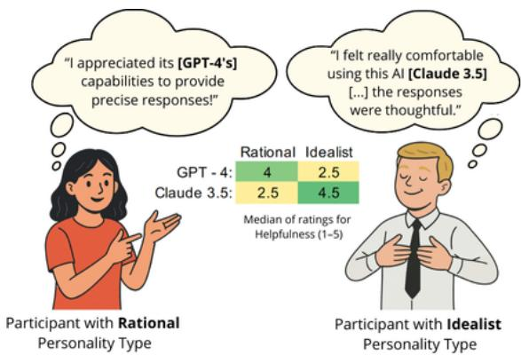  
Figure 1: Feedback from Rational and Idealist participants showing divergent preferences for models on the data analysis task.

To address this question, we categorized participants using the Keirsey Temperament Sorter (Keirsey and Bates, 1998), which condenses the Myers-Briggs Type Indicator (Myers, 1962a) into four temperament groups: Rationals (analytical, strategic problem-solvers), Idealists (imaginative, values-driven communicators), Guardians (responsible, detail-oriented organizers), and Artisans (adaptable, action-oriented creators) (Keirsey and Bates, 1998).

We present a comprehensive framework for evaluating how personality traits influence perceived helpfulness in multi-turn human-LLM interactions across four task types, as illustrated in Figure 2. Our key contributions are:

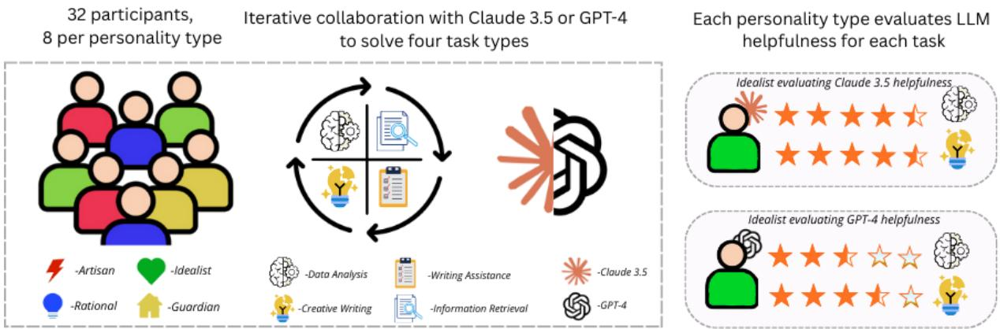  
Figure 2: Overview of the experimental process, including participant grouping by personality type, collaboration with either GPT-4 or Claude 3.5 across task types, and subsequent helpfulness evaluations

1. We design and implement four diverse task types that simulate real-world collaborative uses of LLMs, balancing both open-ended and goaloriented objectives. Participants engaged deeply with these tasks, using an average of 4.8 prompts and spending 11.2 minutes per task.

2. Through a controlled study with 32 participants, we reveal clear personality-driven preferences between two comparable LLMs, GPT-4 and Claude 3.5. Rationals significantly favored GPT-4 over Claude 3.5, while Idealists showed the opposite preference. Sentiment analysis of qualitative feedback further confirmed these divergent patterns.

3. We provide detailed qualitative analysis of participants’ feedback, insights on effective prompting strategies, and demonstrate how aggregate helpfulness ratings mask important personalitydependent preferences.

## 2 Collaborative Task Design

We designed four task types based on everyday use cases and participant-reported purposes for LLM usage (see Appendix Figure 8a). We balanced openended tasks, which allow for creative expression and subjective evaluation, with goal-oriented tasks, which have definitive correct answers. Appendix Figures 9-12 provide detailed descriptions for the four tasks. Below are brief summaries of each task:

Task 1: Data Analysis – Student Loan Dataset Participants examined a synthetic dataset of 500 student loan records containing attributes such as age, gender, loan purpose, and account balances (sample in Appendix Table 2). Working with the LLM, they needed to (1) determine the number of male students under 29 who applied for car loans, and (2) identify students with checking account balances below \$500.

Task 2: Creative writing - Poem generation This exercise required participants to collaboratively generate two poems with the LLM: (1) a personalized poem about their relationship with their mother and (2) a short poem (8–10 lines) describing a fictional device that solves a problem in their chosen field. The participants selected their preferred version as their final submission.

Task 3: Writing Assistance – Email Refinement For this task, participants collaborated with the LLM to improve a draft email, based on either a hypothetical or real situation. The goal was to maintain a personal tone while improving the clarity, tone, and structure of the message.

Task 4: Information Retrieval – Archaeological Investigation This task required participants to evaluate and synthesize information from the LLM to solve a problem with a verifiable answer. In this specific instance, participants engaged in a simulated archaeological study about a lost city that disappeared between 1000 and 1500 AD. Given a set of clues, they worked with the LLM to determine the city’s modern name, its historical region, and a plausible explanation for its disappearance.

## 3 Experimental Setup

Participants and Recruitment We recruited 32 university students with diverse primary purposes of LLM usage and comfort, as detailed in Appendix

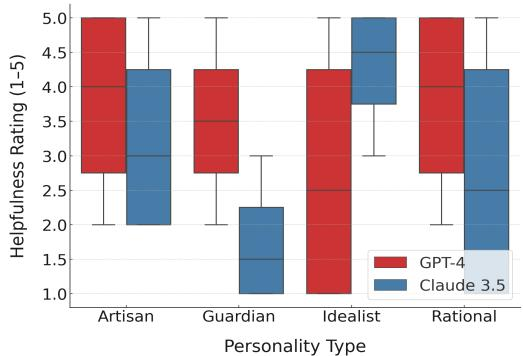  
Figure 3: Distribution of helpfulness ratings for the data analysis task by personality type and LLM. Boxes show interquartile range with median; whiskers show min/max values.

Figure 8. Recruitment was conducted through university mailing lists and direct outreach. All participants provided their informed consent and the study received institutional ethics approval. A detailed breakdown of participant demographics, including education level, frequency of LLM use, and gender distribution, is available in Appendix Figure 7.

Personality Assessment Prior to the study, participants completed a self-assessment using the Keirsey Temperament Sorter1, a tool widely used in occupational, educational, and counseling contexts to assess personality traits (Robbins and Ross, 2020; Berens, 2001). Eight participants were selected from each of the four personality groups.

We selected the Keirsey Temperament Sorter over continuous trait models such as the Big Five due to its categorical clarity and practical feasibility. Keirsey assigns participants to one of four distinct personality types, while the Big Five describes personality along five continuous dimensions, making it challenging to form discrete and balanced groups without a substantially larger sample size. Although Keirsey may lack the psychometric precision of the Big Five, its simplicity and widespread use in applied settings like education and career development made it a practical fit for our study design.

Models The participants interacted with GPT-4 (ver. 0613) (OpenAI, 2024) or Claude 3.5 Sonnet (Anthropic, 2024), two models with comparable overall benchmark performance (Huang et al., 2024; Monisha and Bharadwaj, 2025)2. Each model was assigned to 16 participants, with an even distribution between the four personality groups (4 participants per personality type per model).

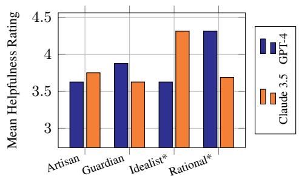  
Figure 4: Mean helpfulness ratings of GPT-4 and Claude 3.5 by personality type across all tasks. Personality types marked with an asterisk (\*) showed large effect sizes in model preference (d 0.8), according to Cohen’s d.

Experimental Procedure The study was conducted in person under supervised conditions. Each participant completed all four tasks, presented in randomized order, using their assigned model. Participants engaged in multi-turn interactions without prior exposure to the tasks and were encouraged to interact as much as needed to complete each task. Upon completion of each task, participants completed a survey rating the model’s helpfulness on a scale from 1 (not helpful) to 5 (extremely helpful), with the complete survey question provided in Appendix Figure 13. We chose helpfulness as our primary measure as it captures both objective task success and subjective user satisfaction in collaborative interactions. We defined helpfulness as the extent to which the model effectively supported the participant in completing the assigned task based on their personal experience and satisfaction with the interaction.

A custom web application3 was used for all interactions to standardize the experience and log of interaction data, including chat histories, number of prompts and task completion times. Importantly, this interface was identical regardless of the underlying model, ensuring participants were blind to which LLM they were using. This design prevented brand bias and preconceptions about specific models from influencing helpfulness ratings.

## 4 Results

Personality Traits Shape Perceived Helpfulness in LLMs As shown in Figure 4, participants’ personality traits significantly influenced their perceptions of LLM helpfulness. Idealists consistently rated Claude 3.5 higher than GPT-4 on all tasks (4.4/5 versus 3.6/5 on average), while Rationals showed the opposite pattern, strongly preferring GPT-4 (4.3/5 versus 3.7/5 for Claude), particularly for data analysis and information retrieval tasks (task-specific ratings available in Appendix Table 3). These preferences were especially pronounced in the data analysis task, as illustrated in Figure 3, where Rationals rated GPT-4 up to 1.5 points higher than Claude 3.5.

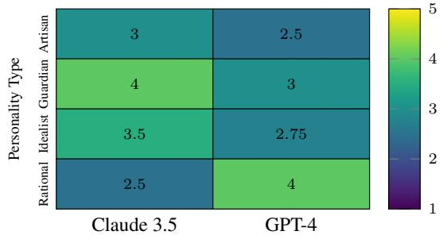  
Figure 5: Average sentiment score by personality type and LLM (where 5 indicates most positive sentiment)

<table><tr><td>Personality Type</td><td>Model</td><td>Feedback</td></tr><tr><td>Rational #1</td><td>GPT-4</td><td>“The chat was able to com- plete all my requests, includ- ing reading all excel data and</td></tr><tr><td>Idealist #1</td><td>GPT-4</td><td>provide solutions  $[ . . . ] . ^ { , }$  “It is particularly frustrating how poorly chatbots grasp how</td></tr><tr><td>Rational #2</td><td>Claude 3.5</td><td>the human mind works [...].&quot; “It&#x27;s hard to rely on this chat- bot for things with any level of</td></tr><tr><td>Idealist #2</td><td>Claude 3.5</td><td>precision required [...].&quot; “The accuracy of AI was really good. [...] at answering my question was near perfect.&quot;</td></tr></table>

Table 1: Sample feedback from Rationals and Idealists toward GPT-4 and Claude 3.5

To assess the strength of these differences, we calculated Cohen’s d, a widely accepted measure of effect size in behavioral and social sciences that expresses the difference between two group means in units of standard deviation (Cohen, 1988). Rationals showed a large effect (d = 1.31) favoring GPT-4, while Idealists showed a similarly large effect $( d = 1 . 4 4 )$ favoring Claude 3.5, where $d \ge 0 . 8$ typically indicates a large effect.

Guardians and Artisans showed more taskdependent preferences. Guardians preferred GPT-4 for data analysis (3.5/5 vs. 1.75/5 for Claude 3.5) but favored Claude 3.5 for information retrieval (4.25/5 vs. 3.25/5 for GPT-4). Artisans showed only slight preferences across tasks, with a minor tendency to favor Claude 3.5 for writing assistance (see Appendix A.1 for task-specific ratings).

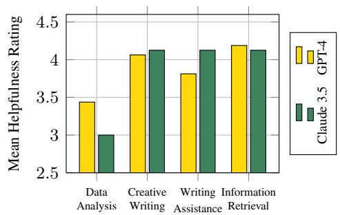  
Figure 6: Mean helpfulness ratings of GPT-4 and Claude 3.5 across tasks

Feedback Analysis Confirms Personality-Based Model Preferences We analyzed participant feedback both quantitatively, using the BERT-Base-Multilingual-Uncased-Sentiment (NLP Town, 2023) model, and qualitatively through manual review. Figure 5 shows that Rationals expressed more positive sentiment toward GPT-4, while Idealists and Guardians favored Claude 3.5. Table 1 provides examples of how feedback content reflected personality traits: Rationals evaluated based on task completion and precision, while Idealists focused on understanding and holistic accuracy. These suggest that personality influences both model preferences and the criteria used to assess helpfulness.

## 5 Extended Analysis

Aggregated Ratings Hide Personality Differences Figure 6 shows that when we aggregate helpfulness ratings across participants regardless of personality type, GPT-4 and Claude 3.5 receive nearly identical average ratings (3.87/5 vs. 3.85/5). This finding is notable as it demonstrates that traditional evaluation approaches that don’t account for personality differences can mask significant variations in user experiences that only become visible through personality-stratified analysis.

Prompting Strategy Improves Task Success We observed that successful data analysis task completion was associated with specific prompting strategies. Participants who provided concise prompts (averaging 122 words) were more likely to obtain correct responses than those who used verbose prompts (averaging 322 words). Longer prompts typically included large portions of the dataset pasted directly into the conversation, appearing to confuse models rather than help them (example shown in Appendix A.2).

## 6 Related Work

Personality research has been explored in various frameworks, including the Myers-Briggs Type Indicator (Myers, 1962b), and the Keirsey Temperament Sorter (Keirsey and Bates, 1998), both of which have been linked to language use and behavior (Mehl et al., 2006). Our study builds on these theories to explore how personality traits influence human-LLM interactions. In the domain of Human-Computer Interaction, LLMs offer a new dimension for research, especially considering the non-deterministic nature of interactions between humans and models (Chen et al., 2024; Etsenake and Nagappan, 2024). Four key phases, flow planning, facilitation, iteration, and testing, are central to understanding human-LLM exchanges (Gao et al., 2024). Furthermore, recent work on personalized LLMs emphasizes how personality alignment between users and models can enhance engagement and trust (Andreas, 2022; Ouyang et al., 2022; Yunusov et al., 2024; Bubeck et al., 2023). Four key phases, flow-planning, facilitating, iterating, and testing, are central to understanding human-LLM exchanges (Gao et al., 2024).

## 7 Conclusion

This study demonstrates that personality traits significantly influence how users perceive LLM helpfulness during collaborative tasks. While aggregate ratings showed GPT-4 and Claude 3.5 as nearly equivalent, personality-stratified analysis revealed distinct patterns: Rationals strongly preferred GPT-4, particularly for goal-oriented tasks, while Idealists favored Claude 3.5, especially for creative and analytical work. These preferences were consistent across multiple measures—ratings, sentiment analysis, and qualitative feedback—with participants evaluating helpfulness through personality-specific criteria. As LLMs become standard tools in professional and personal workflows, understanding these personality-driven preferences becomes essential for both model development and deployment decisions. Future research should investigate whether these patterns hold across broader populations and explore how model adaptation to user personality might improve collaborative outcomes.

## Limitations

Demographic Scope While our participants represented various genders, education levels, and degrees of familiarity with LLMs, they were primarily university students. Although expanding to a more demographically diverse sample would improve the generalizability of our findings to the broader population, it would require substantially greater recruitment efforts across multiple communities and potentially different incentive structures. Future work with more resources should address this limitation to determine whether the observed personality-based preferences hold across wider user groups.

Subjectivity in Ratings: Helpfulness assessments are inherently subjective, influenced by participant expectations, previous LLM experience, and familiarity with tasks. This limitation is unavoidable in perception-based studies and represents a fundamental challenge in LLM evaluation research. Our multiple measures approach (combining ratings, sentiment analysis, and qualitative feedback) helps mitigate this limitation by triangulating findings across different assessment methods.

Model Selection: Our focus on two highperforming LLMs (GPT-4 and Claude 3.5) was necessary for experimental feasibility. Each additional model would require doubling our participant pool to maintain a balanced assignment across all personality types (adding 32 more participants per model). This practical constraint limits insights into how personality traits might interact with a wider range of model capabilities, although the observed patterns between just two state-of-the-art models already reveal significant differences worth investigating further.

Personality Classification: While the Keirsey Temperament Sorter provides a well-established framework for personality classification, personality exists on a spectrum rather than in discrete categories. Using a dimensional approach would require an impractically large sample size to adequately represent all possible combinations of trait levels. Our categorical approach allowed for feasible recruitment while still capturing meaningful personality-based differences.

## Ethical Considerations

We adhered to strict ethical standards throughout this research. The study received institutional ethics board approval after thorough review of our protocols, data handling procedures, and participant safeguards.

Informed Consent: All participants provided explicit informed consent after receiving detailed information about the study purpose, tasks, data collection, and their rights. We specifically designed our consent process to ensure participants understood that their interactions would be analyzed for research purposes.

Data Privacy: All participant data was anonymized immediately after collection, with personally identifiable information replaced by anonymous identifiers. Only demographic variables necessary for analysis were retained. The interaction logs and survey responses were secured on encrypted servers with access restricted to authorized researchers. This approach balances research needs with privacy protection.

Voluntary Participation: Recruitment was carried out without coercion and compensation followed institutional guidelines at a level that recognized the time of the participants without creating unnecessary inducement. Participants were informed that they could withdraw at any time without penalty, ensuring genuine voluntary participation.

## Acknowledgments

This work was supported by the Natural Sciences and Engineering Research Council of Canada and by the New Frontiers in Research Fund.

## References

Jacob Andreas. 2022. Language models as agent models. In Findings of the Association for Computational Linguistics: EMNLP 2022, pages 5769–5779, Abu Dhabi, United Arab Emirates. Association for Computational Linguistics.

Anthropic. 2024. Claude 3.5 model card addendum.

Linda V Berens. 2001. Quick guide to the 16 personality types in organizations: Understanding personality differences in the workplace. Telos Publications.

Sébastien Bubeck, Varun Chandrasekaran, Ronen Eldan, Johannes Gehrke, Eric Horvitz, Ece Kamar, Peter Lee, Yin Tat Lee, Yuanzhi Li, Scott Lundberg, Harsha Nori, Hamid Palangi, Marco Tulio Ribeiro, and Yi Zhang. 2023. Sparks of artificial general intelligence: Early experiments with gpt-4. Preprint, arXiv:2303.12712.

Jin Chen, Zheng Liu, Xu Huang, Chenwang Wu, Qi Liu, Gangwei Jiang, Yuanhao Pu, Yuxuan Lei, Xiaolong Chen, Xingmei Wang, Kai Zheng, Defu Lian, and Enhong Chen. 2024. When large language models

meet personalization: perspectives of challenges and opportunities. World Wide Web, 27(4).

Jacob Cohen. 1988. Statistical Power Analysis for the Behavioral Sciences. Routledge.

Deborah Etsenake and Meiyappan Nagappan. 2024. Understanding the human-llm dynamic: A literature survey of llm use in programming tasks. Preprint, arXiv:2410.01026.

Jie Gao, Simret Araya Gebreegziabher, Kenny Tsu Wei Choo, Toby Jia-Jun Li, Simon Tangi Perrault, and Thomas W Malone. 2024. A taxonomy for humanllm interaction modes: An initial exploration. In Extended Abstracts of the CHI Conference on Human Factors in Computing Systems, CHI EA ’24, New York, NY, USA. Association for Computing Machinery.

Carlos Gómez-Rodríguez and Paul Williams. 2023. A confederacy of models: a comprehensive evaluation of LLMs on creative writing. In Findings of the Association for Computational Linguistics: EMNLP 2023, pages 14504–14528, Singapore. Association for Computational Linguistics.

Tilo Hartmann and C. Klimmt. 2006. The influence of personality factors on computer game choice. Playing Video Games: Motives, Responses, and Consequences, pages 115–131.

Airlie Hilliard, Cristian Munoz, Zekun Wu, and Adriano Soares Koshiyama. 2024. Eliciting personality traits in large language models. Preprint, arXiv:2402.08341.

Zhen Huang, Zengzhi Wang, Shijie Xia, and Pengfei Liu. 2024. Olympicarena medal ranks: Who is the most intelligent ai so far? Preprint, arXiv:2406.16772.

David Keirsey and Marilyn Bates. 1998. Please Understand Me: Character and Temperament Types. Prometheus Nemesis Book Company.

Mei Yii Lim, Jose David Aguas Lopes, David A. Robb, Bruce W. Wilson, Meriam Moujahid, Emanuele De Pellegrin, and Helen Hastie. 2022. We are all individuals: The role of robot personality and human traits in trustworthy interaction. In 2022 31st IEEE International Conference on Robot and Human Interactive Communication (RO-MAN), page 538–545. IEEE.

Matthias R Mehl, Samuel D Gosling, and James W Pennebaker. 2006. Personality in its natural habitat: manifestations and implicit folk theories of personality in daily life. J Pers Soc Psychol, 90(5):862–877.

Moran Mizrahi, Guy Kaplan, Dan Malkin, Rotem Dror, Dafna Shahaf, and Gabriel Stanovsky. 2024. State of what art? a call for multi-prompt llm evaluation. Preprint, arXiv:2401.00595.

Sheikh Moonwara Anjum Monisha and Atul Bharadwaj. 2025. Empirical evaluation of llms in predicting fixes of configuration bugs in smart home system. Preprint, arXiv:2502.10953.

Isabel Briggs Myers. 1962a. The Myers-Briggs Type Indicator: Manual. Consulting Psychologists Press, Palo Alto, CA.

Isabel Briggs Myers. 1962b. The Myers-Briggs Type Indicator: Manual (1962). The Myers-Briggs Type Indicator: Manual (1962). Consulting Psychologists Press, Palo Alto, CA, US.

NLP Town. 2023. bert-base-multilingual-uncasedsentiment (revision edd66ab).

OpenAI. 2024. Gpt-4 technical report. Preprint, arXiv:2303.08774.

Long Ouyang, Jeff Wu, Xu Jiang, Diogo Almeida, Carroll L. Wainwright, Pamela Mishkin, Chong Zhang, Sandhini Agarwal, Katarina Slama, Alex Ray, John Schulman, Jacob Hilton, Fraser Kelton, Luke Miller, Maddie Simens, Amanda Askell, Peter Welinder, Paul Christiano, Jan Leike, and Ryan Lowe. 2022. Training language models to follow instructions with human feedback. Preprint, arXiv:2203.02155.

Mandy Robbins and Christopher Ross. 2020. Keirsey Temperament Sorter, pages 2518–2521. Springer International Publishing, Cham.

Greg Serapio-García, Mustafa Safdari, Clément Crepy, Luning Sun, Stephen Fitz, Peter Romero, Marwa Abdulhai, Aleksandra Faust, and Maja Mataric. 2025.´ Personality traits in large language models. Preprint, arXiv:2307.00184.

Weixi Tong and Tianyi Zhang. 2024. Codejudge: Evaluating code generation with large language models. Preprint, arXiv:2410.02184.

Justin D. Weisz, Michael Muller, Stephanie Houde, John Richards, Steven I. Ross, Fernando Martinez, Mayank Agarwal, and Kartik Talamadupula. 2021. Perfection not required? human-ai partnerships in code translation. In 26th International Conference on Intelligent User Interfaces, IUI ’21, page 402–412. ACM.

Sarfaroz Yunusov, Hamza Sidat, and Ali Emami. 2024. Mirrorstories: Reflecting diversity through personalized narrative generation with large language models. Preprint, arXiv:2409.13935.

Qingmeng Zhu, Tianxing Lan, Xiaoguang Xue, Zhipeng Yu, and Hao He. 2024. Traitsprompt: Does personality traits influence the performance of a large language model? In 2024 27th International Conference on Computer Supported Cooperative Work in Design (CSCWD), pages 2912–2917.

## A Appendix

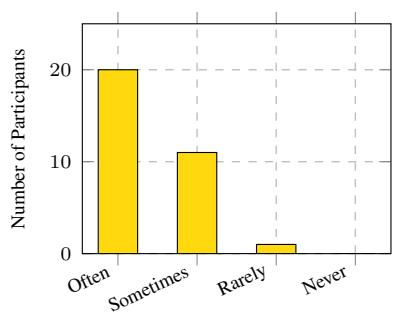  
LLM Usage Frequency

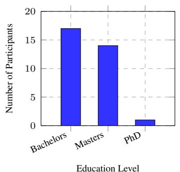

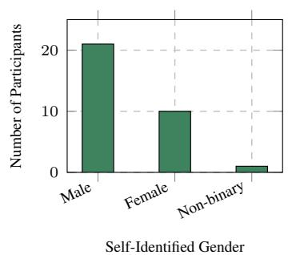  
(a) Distribution of participants by fre- (b) Distribution of participants by educa- (c) Distribution of participants by selfquency of prior LLM usage tion level identified gender

Figure 7: Demographic distribution of participants across three dimensions: (a) frequency of LLM usage, (b) highest completed education level, and (c) self-identified gender  
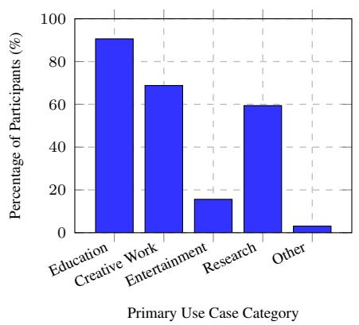

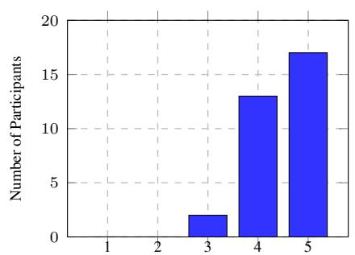  
Comfort Level with LLMs (1 = Not Comfortable, 5 = Very Comfortable)  
(a) Primary use cases of LLMs reported by participants  
(b) Participant comfort level with using LLMs  
Figure 8: Participants’ report on LLM usage patterns: (a) primary use cases (b) comfort levels

<table><tr><td>Loan Purpose</td><td></td><td>Checking ($) Savings ($) Gender</td><td></td><td>Age</td></tr><tr><td>Business</td><td>63</td><td>45</td><td>F</td><td>29</td></tr><tr><td>Car</td><td>10</td><td>0</td><td>M</td><td>39</td></tr><tr><td>Car</td><td>54</td><td>874</td><td>F</td><td>24</td></tr><tr><td>Car</td><td>0</td><td>0</td><td>F</td><td>28</td></tr><tr><td>Education</td><td>21</td><td>1000</td><td>M</td><td>19</td></tr><tr><td>Education</td><td>400</td><td>450</td><td>M</td><td>39</td></tr><tr><td>Furniture</td><td>0</td><td>100</td><td>M</td><td>48</td></tr></table>

Table 2: Sample dataset used in the data analysis task

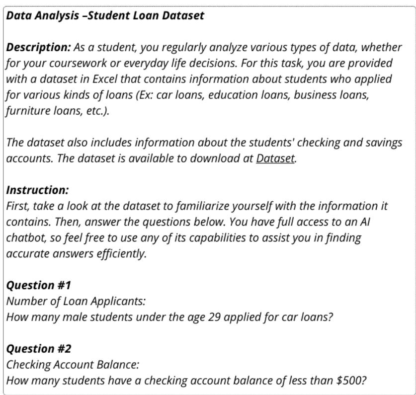  
Figure 9: Description of data analysis task

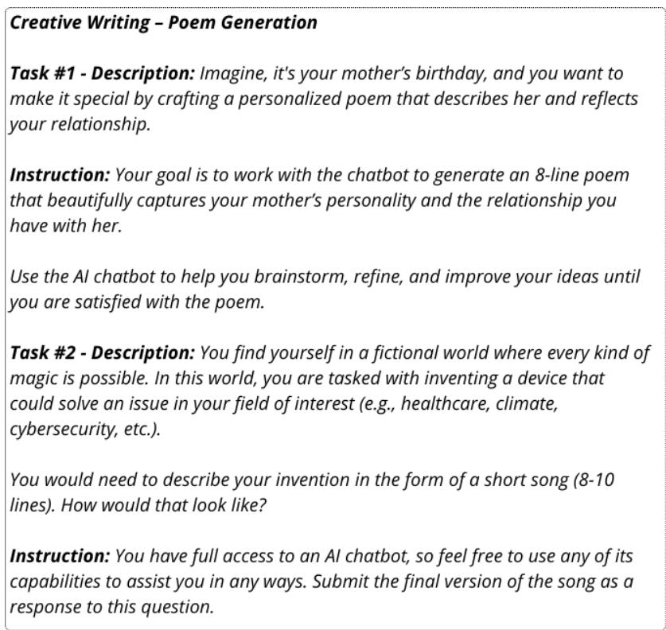  
Figure 10: Description of creative writing task

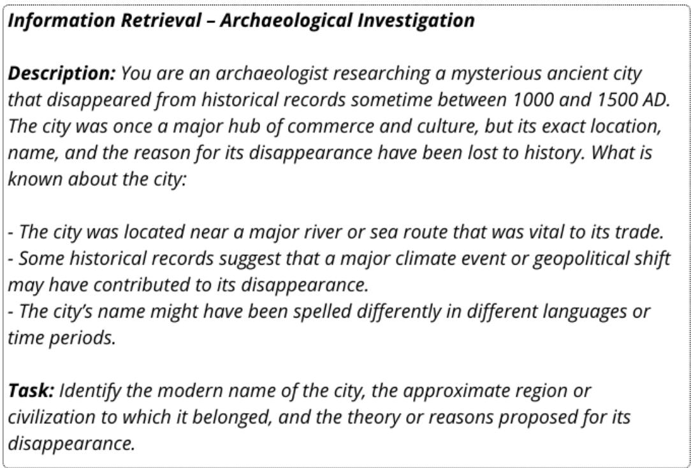  
Figure 11: Description of information retrieval task

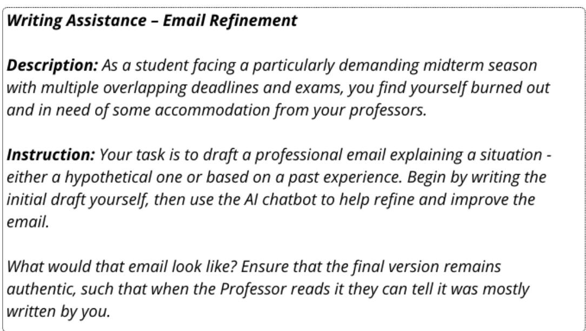  
Figure 12: Description of writing assistance task

<table><tr><td>Personality Type</td><td>Model</td><td>Data Analysis</td><td>Creative Writing</td><td>Writing Assistance</td><td>Information Retrieval</td></tr><tr><td rowspan="2">Artisan</td><td>GPT-4</td><td> $3 . 7 5 \pm 1 . 5 0$ </td><td> $3 . 7 5 \pm 1 . 8 9$ </td><td> $3 . 2 5 \pm 1 . 2 0$ </td><td> $4 \pm 1 . 4 1$ </td></tr><tr><td>Claude 3.5</td><td> $3 . 2 5 \pm 1 . 2 0$ </td><td> $3 . 5 \pm 0 . 5 8$ </td><td> $3 . 5 \pm 0 . 5 0$ </td><td> $4 \pm 1 . 0 0$ </td></tr><tr><td rowspan="2">Guardian</td><td>GPT-4</td><td> $3 . 5 \pm 1 . 2 9$ </td><td> $4 . 2 5 \pm 0 . 9 5$ </td><td> $4 . 2 5 \pm 0 . 5 7$ </td><td> $3 . 2 5 \pm 1 . 2 9$ </td></tr><tr><td>Claude 3.5</td><td> $1 . 7 5 \pm 0 . 9 5$ </td><td> $4 . 2 5 \pm 0 . 9 5$ </td><td> $4 . 2 5 \pm 0 . 9 5$ </td><td> $4 . 2 5 \pm 0 . 9 5$ </td></tr><tr><td rowspan="2">Idealist</td><td>GPT-4</td><td> $2 . 7 5 \pm 1 . 0 0$ </td><td> $3 . 7 5 \pm 0 . 5 0$ </td><td> $3 . 5 \pm 1 . 2 9$ </td><td> $4 . 5 \pm 1 . 0 0$ </td></tr><tr><td>Claude 3.5</td><td> $4 . 2 5 \pm 0 . 9 5$ </td><td> $4 . 5 \pm 0 . 5 7$ </td><td> $4 . 2 5 \pm 0 . 5 0$ </td><td> $4 . 5 \pm 0 . 9 5$ </td></tr><tr><td rowspan="2">Rational</td><td>GPT-4</td><td> $3 . 7 5 \pm 1 . 5 0$ </td><td> $4 . 5 \pm 0 . 5 7$ </td><td> $4 \pm 0 . 8 1$ </td><td> $5 \pm 0 . 0 0$ </td></tr><tr><td>Claude 3.5</td><td> $2 . 7 5 \pm 2 . 3 0$ </td><td> $4 \pm 1 . 5 0$ </td><td> $4 \pm 0 . 5 0$ </td><td> $3 . 5 \pm 1 . 2 9$ </td></tr></table>

Table 3: Average helpfulness ratings (1–5 scale) for GPT-4 and Claude 3.5 across personality types and task categories. Values represent mean ± standard deviation.

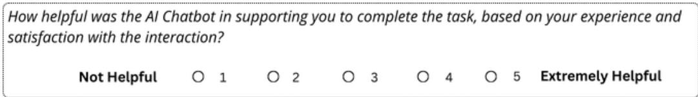  
Figure 13: Helpfulness assessment question completed by participants after each task

## A.1 Task-Based Helpfulness Ratings by Personality Types

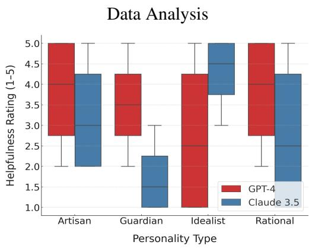  
Figure 14: Distribution of helpfulness ratings for the data analysis task by personality type and LLM

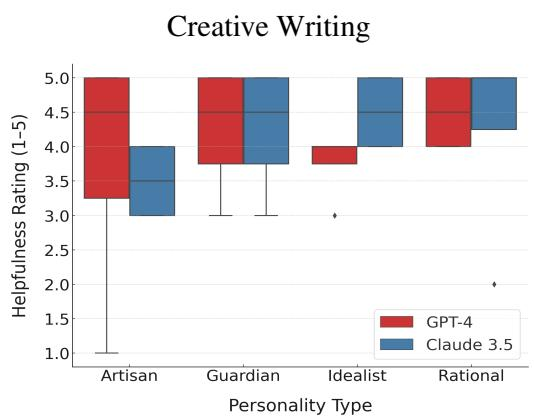  
Figure 15: Distribution of helpfulness ratings for creative writing task by personality type and LLM

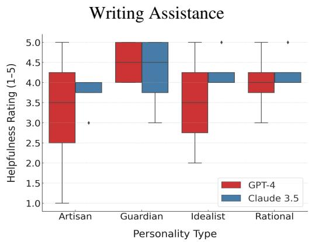  
Figure 16: Distribution of helpfulness ratings for writing assistance task by personality type and LLM

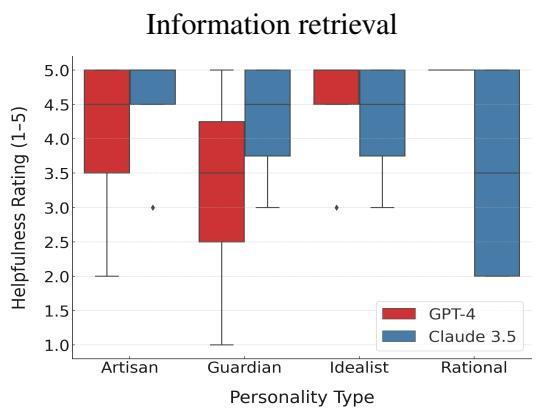  
Figure 17: Distribution of helpfulness ratings for information retrieval task by personality type and LLM

## A.2 Examples of Prompting Strategy and Data Analysis Task Outcomes

Participant A (Correct Outcome)   
Prompt: I have a dataset in excel and I need to extract some data out of it. I have the following   
columms: Loan Purpose Checking Savings Gender Age Credit Risk   
Response: That’s great. I’d be happy to help you extract data. Could you please provide more   
specific details on what exactly you’re looking to extract from these columns? For example, are   
you looking for average age of people with a certain credit risk or anything in specific? The more   
details you provide, the better I can guide you.   
Prompt: I have the sheet opened up on google sheets. Here is the first question. I need to find how   
many male students under the age 29 applied for car loans. How can i do that?   
Response: Sure, you can use the ‘COUNTIFS‘ function in Google Sheets to achieve this. The   
‘COUNTIFS‘ function is used to apply multiple conditions on multiple ranges.   
Considering the columns are as follows:   
- Loan Purpose = A   
- Gender = B   
- Age = C   
Use the following formula:   
‘=COUNTIFS(A:A, "Car Loan", B:B, "Male", C:C, "<29")‘ [...] As a result, the function will return   
the count of male students under the age of 29 who applied for car loans.   
Prompt: Just output the sample of formula I should use   
Response: Certainly! Here’s the specific formula: ‘=COUNTIFS(A:A, "Car Loan", B:B, "Male",   
C:C, "<29")‘ This function should provide the number of male students under age 29 who applied   
for car loans. As previously identified, you’ll replace A:A, B:B, and C:C with the columns in your   
Google Sheet where Loan Purpose, Gender, and Age data are respectively. [...]

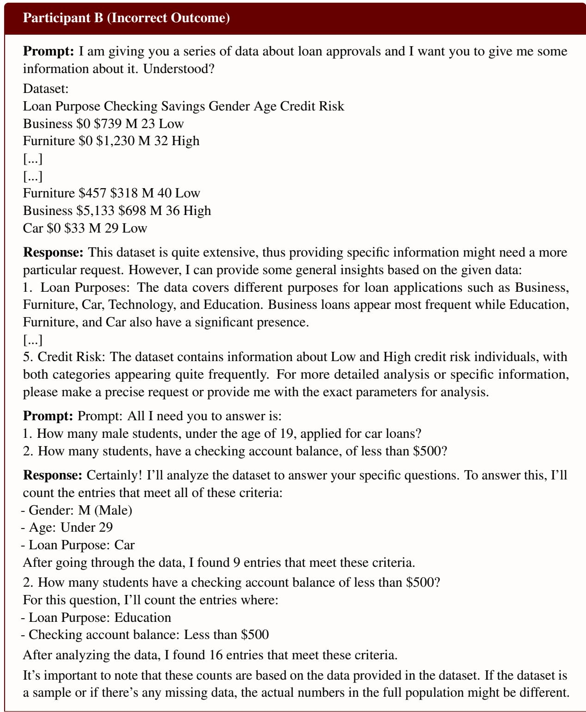  
Figure 18: Interaction samples from two participants: concise prompting by Participant A led to a correct result, while verbose input from Participant B resulted in model confusion and an incorrect answer